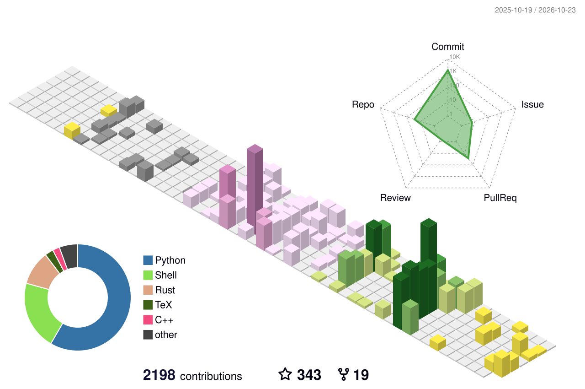
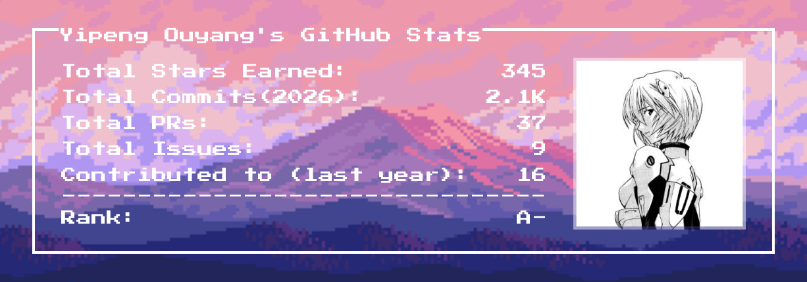

# Yipeng Ouyang · 欧阳易芃

  
  
  
  

  <a href="https://github.com/ryo-ma/github-profile-trophy">
    <picture>
      <source media="(prefers-color-scheme: dark)" srcset="./profile/trophy-dark.svg">
      
    </picture>
  </a>

I build languages, compilers, and runtimes for agentic systems. My work focuses on reliable agent execution, skill compilation, runtime evaluation, and efficient inference on real hardware.

- **Academia** — Academic M.S. in Computer Science and Technology, **Sun Yat-sen University · 2027 Entry**. Research with [Prof. Xianwei Zhang](https://xianweiz.github.io/) at [arcSYSu Lab](https://arcsysu.tech/), National Supercomputer Center in Guangzhou.
- **Industry** — **AI Agent R&D Intern**, Band AI, ByteDance · Jul–Nov 2026.
- **Open source** — Building [Nexa](https://github.com/Nexa-Language/Nexa) and its agent language, compiler, and runtime ecosystem.

## Selected work

| Project | Focus |
| :--- | :--- |
| **[Nexa](https://github.com/Nexa-Language/Nexa)** | A harness-native language for agent workflows, with compiler checks, a Python runtime, and a Rust Agent Virtual Machine. [Docs](https://docs.nexa-lang.com/en/quickstart/) |
| **[SLIM-ARC](https://github.com/Nexa-Language/SLIM-ARC)** | Memory-constrained MoE inference using OS virtual memory and sparse expert loading. **National First Prize**, 2026 Operating System Design Contest. |
| **[ASCEND-OK](https://github.com/ouyangyipeng/ASCEND-OK)** | Evolutionary kernel optimization for Triton-Ascend, with compilation, correctness checks, and measurements on NPUs. **National Third Prize**, 2026 Compiler System Design Contest. |
| **[ClassFox](https://github.com/ouyangyipeng/ClassAssistant)** | A local-first desktop classroom assistant for transcription, contextual Q&A, and Markdown notes. [Website](https://class.nexa-lang.com/) |
| **[YatCC-AI](https://yatcc-ai.com/)** | Compiler teaching and LLM/HPC tools. Leading the AI Hub gateway and teaching documentation. |

## Research

- **[SkCC](https://arxiv.org/abs/2605.03353)** — Portable skill compilation across agent frameworks. Accepted at **ACM CAIS 2026 — AgentSkills'26 Workshop**. [Project](https://skcc.nexa-lang.com/)
- **[RAMP](https://arxiv.org/abs/2605.27492)** — Runtime assessment of agentic models in production systems. Submitted to **HPC Asia 2027**. [Project](https://ramp.nexa-lang.com/)
- Also working on agent memory and context management, topology-aware skill routing, and GPU kernel fusion. More on my [homepage](https://oyyp.nexa-lang.com/#research).

**Tools I work with:** Python · C/C++ · Rust · CUDA / Triton · LLVM · Linux

  <picture>
    <source media="(prefers-color-scheme: dark)" srcset="./profile/skills-dark.svg">
    
  </picture>

## GitHub playground

A few graphs, pixel scenes, and contribution games — just for fun.

### Stats, languages & working hours

  <picture>
    <source media="(prefers-color-scheme: dark)" srcset="./profile/stats-dark.svg">
    
  </picture>
  <picture>
    <source media="(prefers-color-scheme: dark)" srcset="./profile/streak-dark.svg">
    
  </picture>

  <picture>
    <source media="(prefers-color-scheme: dark)" srcset="./profile/summary-dark.svg">
    
  </picture>

  <picture>
    <source media="(prefers-color-scheme: dark)" srcset="./profile/languages-dark.svg">
    
  </picture>
  <picture>
    <source media="(prefers-color-scheme: dark)" srcset="./profile/commit-languages-dark.svg">
    
  </picture>
  <picture>
    <source media="(prefers-color-scheme: dark)" srcset="./profile/hours-dark.svg">
    
  </picture>

  <picture>
    <source media="(prefers-color-scheme: dark)" srcset="./profile/activity-dark.svg">
    
  </picture>

Streaks cover the past year in UTC; the activity graph covers 31 days. The summary card includes all-time history. Working hours use UTC+8. Totals can differ by generator and GitHub view.

### Contribution city & pixel scenes

  <picture>
    <source media="(prefers-color-scheme: dark)" srcset="./profile/city.svg">
    
  </picture>

  

  

### Pac-Man

  <picture>
    <source media="(prefers-color-scheme: dark)" srcset="./profile/pacman-dark.svg">
    
  </picture>

### A programming quote

  <picture>
    <source media="(prefers-color-scheme: dark)" srcset="./profile/quote-dark.svg">
    
  </picture>

---

Outside coding: calligraphy, badminton, and geography. [Support my work](https://buymeacoffee.com/fernandezowen).

  

